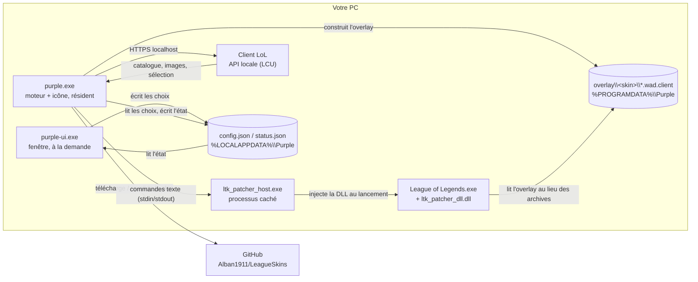

# Purple

**Changeur de skins pour League of Legends, léger et autonome, écrit en Rust.**

Choisissez un skin par champion ; dès que vous sélectionnez ce champion en sélection des champions, Purple le
prépare et le fait charger par le jeu. Le skin n'est visible que par vous : c'est une modification locale.


> [!WARNING]
> Riot Games n'autorise pas les outils qui modifient les fichiers du jeu, même côté client. Leur utilisation
> se fait **à vos risques** (une suspension de compte est possible). Purple est un projet personnel, sans lien
> avec Riot Games.

---

## Sommaire

- [Points clés](#points-clés)
- [Installation et utilisation](#installation-et-utilisation)
- [Fonctionnement](#fonctionnement)
- [Dépendances externes](#dépendances-externes)
- [Données et configuration](#données-et-configuration)
- [Dépannage](#dépannage)
- [Développement](#développement)
- [Limites et feuille de route](#limites-et-feuille-de-route)
- [Crédits et licences](#crédits-et-licences)

---

## Points clés

- **Autonome** : ne nécessite aucune autre application de skins (ni LTK Manager, ni cslol, ni Rose).
- **Léger** : le programme résident utilise ~15 Mo de RAM ; la fenêtre (~100 Mo) n'est ouverte qu'à la demande.
- **Discret** : une icône dans la zone de notification, aucune fenêtre au démarrage.
- **Privé** : pas de compte, pas de serveur, pas de télémétrie.
- **Sûr pour le jeu** : les archives officielles ne sont jamais modifiées ; Purple travaille sur une copie.

Testé sur Windows 11, serveur EUW, client en français.

---

## Installation et utilisation

### Prérequis

- Windows 10 ou 11 (64 bits) ;
- League of Legends installé ;
- le dossier `dist\Purple`, produit par la [compilation](#compiler).

### Utilisation

1. Lancez **`purple.exe`**. Une icône violette apparaît dans la zone de notification (sous Windows 11, elle est
   d'abord rangée sous la flèche **^** : faites-la glisser vers la barre des tâches pour la garder visible).
2. **Clic gauche** sur l'icône (ou clic droit → *Open Purple*) pour ouvrir la fenêtre. Choisissez un champion à
   gauche, puis un skin à droite. Cliquez à nouveau sur le skin, ou sur *Use the default skin*, pour annuler.
   Une pastille violette signale les champions qui ont un skin choisi.
3. Lancez le client et jouez normalement. En sélection des champions, dès que vous choisissez un champion qui a un
   skin, Purple le prépare (≈ 1 s). Vous pouvez fermer la fenêtre : Purple continue de fonctionner en arrière-plan.
4. Pour quitter : clic droit sur l'icône → *Quit*. Si une partie est en cours, Purple attend sa fin.

### Contenu du dossier

Les fichiers doivent rester **ensemble, dans le même dossier** :

| Fichier | Rôle |
|---|---|
| `purple.exe` | Programme résident (moteur + icône). **C'est celui qu'il faut lancer.** |
| `purple-ui.exe` | Fenêtre de sélection des skins, ouverte depuis l'icône. |
| `purplectl.exe` | Outil en ligne de commande pour le diagnostic. |
| `patcher\` | LTK Patcher (`ltk_patcher_host.exe`, `ltk_patcher_dll.dll`) et sa version. |

---

## Fonctionnement



Les programmes de Purple ne communiquent pas par le réseau : la fenêtre et le moteur échangent via deux fichiers
JSON. Le moteur ne contacte que le client LoL (en local) et GitHub (fichiers de skins).

### Les trois étapes d'un skin

1. **Le fichier de skin.** Un skin est une petite archive `.fantome` (5 à 20 Ko) contenant un `skin0.bin` qui
   redirige le skin de base du champion vers les données du skin choisi. Les modèles et textures sont déjà dans les
   fichiers du jeu : le skin n'est qu'une redirection. Ces archives proviennent du dépôt
   [`Alban1911/LeagueSkins`](https://github.com/Alban1911/LeagueSkins), régénéré à chaque patch du jeu. Purple
   les met en cache et vérifie à chaque utilisation qu'elles sont à jour (requête conditionnelle `ETag`).
2. **L'overlay.** La crate `ltk_overlay` (LeagueToolkit) crée une **copie** de l'archive
   `DATA/FINAL/Champions/<Champion>.wad.client` dans laquelle les fichiers du skin sont ajoutés
   (≈ 0,5 à 1 s, ≈ 110 Mo). La reconstruction est incrémentale : rien n'est refait si ni le jeu ni le skin n'ont changé.
3. **Le patcher.** `ltk_patcher_host.exe` attend le lancement de `League of Legends.exe` et y injecte
   `ltk_patcher_dll.dll`, qui redirige la lecture des archives vers l'overlay. Le patcher doit être armé
   **avant** le lancement de la partie : c'est pourquoi Purple l'arme dès la sélection des champions.

### Cycle du moteur (chaque seconde)

```
client fermé ──► attend (test toutes les 2 s)
client ouvert ─► lit la phase de jeu
ChampSelect ───► champion du joueur local → skin choisi ?
                   oui → récupère le skin → construit l'overlay → arme le patcher
                   non → désarme
                 (changer de champion ou de skin pendant la sélection ré-arme)
InProgress ────► le patcher est attaché au jeu ; il n'est jamais coupé pendant une partie
fin de partie ─► arrête la session du patcher
```

### Architecture du code

Une bibliothèque et trois binaires dans [`crates/purple`](crates/purple) :

| Module | Rôle |
|---|---|
| `main.rs` | `purple.exe` : icône (`tray-icon`), moteur dans un thread, instance unique. |
| `bin/purple-ui.rs`, `gui.rs` | `purple-ui.exe` : fenêtre `egui`/`eframe` (lit `status.json`, écrit `config.json`). |
| `bin/purplectl.rs` | `purplectl.exe` : commandes `status`, `skins`, `set`, `list`, `build`, `run`. |
| `engine.rs` | Boucle du moteur ; émet des `Event` consommés par l'icône et la CLI. |
| `lcu.rs` | Connexion à l'API locale du client (via son `lockfile`). |
| `catalog.rs` | Champions et skins lus depuis le client ; cache `catalog.json`. |
| `store.rs` | Dossiers de données, cache et revalidation des `.fantome`, journal. |
| `overlay.rs` | Construction de l'overlay avec `ltk_overlay`. |
| `patcher.rs` | Pilotage de `ltk_patcher_host.exe` (protocole texte ci-dessous). |
| `config.rs`, `status.rs` | Choix de l'utilisateur et état partagé moteur → fenêtre. |
| `images.rs` | Chargement, réduction et cache des images. |
| `win.rs`, `icon.rs` | Aides Win32 (mutex, job object, focus) et icône dessinée en code. |

Le patcher est lancé sans fenêtre et rattaché à un *job object* Windows (`KILL_ON_JOB_CLOSE`) : si `purple.exe`
s'arrête brutalement, le patcher s'arrête avec lui.

<details>
<summary>Protocole du patcher (stdin/stdout)</summary>

```
→ config loglevel 16          ← ok …
→ config flags 4              ← ok …      (4 = ne pas bloquer sur le scan « anti-skinhack » du DLL)
→ config prefix C:\...\overlay\<skin>\
→ start scan                  ← status … injecting | injected | waiting | exited | failed
→ stop
                              ← dll … <niveau> <message>   (journaux du DLL dans le jeu)
```

</details>

---

## Dépendances externes

Purple dépend de trois projets tiers. Ce sont eux qui déterminent s'il faut intervenir après un patch du jeu.

| Dépendance | Rôle | Remplaçable ? | Que faire après un patch du jeu |
|---|---|---|---|
| **LTK Patcher** ([LeagueToolkit/ltk-manager](https://github.com/LeagueToolkit/ltk-manager)) — binaires **fermés** | Injection dans le jeu | Difficilement (voir ci-dessous) | Le DLL a une date de fin de vie. Si Purple affiche *patcher too old* : `.\scripts\get-patcher.ps1` puis `.\scripts\package.ps1`. |
| **Crates LeagueToolkit** (`ltk_overlay`, `ltk_wad`, `ltk_fantome`…) — Apache-2.0 | Lecture et construction des archives WAD | Code source ouvert, épinglé par `Cargo.lock` | Mettre à jour seulement si le format des archives change (`cargo update`). |
| **[Alban1911/LeagueSkins](https://github.com/Alban1911/LeagueSkins)** | Fichiers `.fantome` des skins | Oui, à terme (génération locale) | Rien : Purple revalide automatiquement les skins en cache. |

À l'exécution, Purple dépend aussi de l'**API locale du client LoL** (LCU), qui fournit le catalogue, les images et la
phase de jeu. Sans client, la fenêtre affiche le dernier catalogue en cache.

### Réduire la dépendance à ces projets

- **LeagueSkins (meilleure piste).** Un skin n'étant qu'une redirection, Purple pourrait générer lui-même le
  `skin0.bin` à partir des fichiers du jeu (crates `ltk_meta`/`ltk_wad`), sans aucun téléchargement. Limite : le dépôt
  contient aussi des correctifs manuels (animations, skins « fixed ») qu'une génération automatique n'aurait pas.
  Approche réaliste : génération locale par défaut, LeagueSkins en complément.
- **LTK Patcher.** C'est la dépendance la plus critique (binaires fermés, à mettre à jour régulièrement), mais aussi
  la plus coûteuse à remplacer : le DLL doit suivre chaque version du jeu. L'alternative open source historique,
  `cslol-dll` (CS:LoL Manager, même organisation), n'a plus de release depuis avril 2026 : elle remplacerait une
  dépendance fermée par une dépendance ouverte mais moins suivie. Le choix retenu est de garder LTK Patcher,
  isolé derrière `patcher.rs` (remplaçable sans toucher au reste), et de rendre sa mise à jour simple et traçable :
  `get-patcher.ps1` récupère la **dernière release stable** et note la version et les SHA-256 dans
  `patcher\PATCHER-VERSION.txt`.
- **Crates LeagueToolkit.** Aucune action nécessaire : code ouvert, versions figées par `Cargo.lock`.

### Trafic réseau

Purple ne contacte que `raw.githubusercontent.com` (skins) ; `get-patcher.ps1` contacte GitHub pour télécharger le
patcher. Aucune télémétrie. *Non vérifié* : le comportement réseau des binaires fermés du patcher.

---

## Données et configuration

| Emplacement | Contenu |
|---|---|
| `%LOCALAPPDATA%\Purple\config.json` | Vos choix : `{"skins": {"<id champion>": <id skin>}}`. |
| `%LOCALAPPDATA%\Purple\status.json` | État du moteur (client, phase, skin armé, avertissements). |
| `%LOCALAPPDATA%\Purple\catalog.json` | Cache des champions et skins. |
| `%LOCALAPPDATA%\Purple\skins\`, `img\` | Cache des `.fantome` (+ `ETag`) et des images. |
| `%LOCALAPPDATA%\Purple\purple.log` | Journal du moteur (remis à zéro au-delà de 1 Mo). |
| `%PROGRAMDATA%\Purple\overlay\`, `state\` | Overlay du dernier skin (≈ 110 Mo) et son état de construction. |

| Variable d'environnement | Effet |
|---|---|
| `PURPLE_DEBUG=1` | Journalise tout le détail du patcher. |
| `PURPLE_DATA_DIR` | Déplace **tous** les dossiers de données (utile pour les tests). |
| `PURPLE_PATCHER_DIR` | Emplacement du patcher (par défaut `patcher\` à côté des exécutables). |

---

## Dépannage

| Symptôme | Cause probable | Solution |
|---|---|---|
| *The patcher is too old for this game version* | Patch du jeu plus récent que le DLL | `.\scripts\get-patcher.ps1` puis `.\scripts\package.ps1` |
| Skin préparé mais pas visible en jeu, `overlay verified 0 wad(s)` dans le journal | Overlay illisible par le jeu | Vérifier que `%PROGRAMDATA%\Purple` est accessible ; ne pas définir `PURPLE_DATA_DIR` sous `C:\Users` |
| *no skin file for … in the LeagueSkins repository* | Skin absent du dépôt (souvent un skin tout récent) | Attendre la mise à jour du dépôt ou choisir un autre skin |
| Rien ne se passe en sélection des champions | Client non détecté | `purplectl status`, puis consulter `purple.log` |
| Le jeu lance une réparation des fichiers | Overlay produit par un outil obsolète (ex. `mod-tools.exe`) | Purple n'est pas en cause ; ne pas mélanger les outils de skins |

Pour suivre le moteur en direct : quittez `purple.exe`, puis lancez `purplectl run` dans un terminal
(ne pas exécuter les deux en même temps).

---

## Développement

### Compiler

Prérequis : [Rust](https://rustup.rs) et un compilateur C (requis par la crate `zstd`).

```powershell
.\scripts\get-patcher.ps1     # télécharge le patcher (dernière release stable) dans vendor\ltk-patcher
.\scripts\package.ps1         # compile en release et assemble dist\Purple
```

Toolchain : le dépôt utilise la toolchain Rust **GNU** avec [w64devkit](https://github.com/skeeto/w64devkit)
(MinGW), sans modifier le `PATH` :

- `rust-toolchain.toml` épingle `stable-x86_64-pc-windows-gnu` ;
- `.cargo/config.toml` contient les chemins de w64devkit (`C:/Users/pierr/tools/w64devkit`) : adaptez-les.
  Avec les Build Tools Visual Studio (C++), supprimez plutôt ces deux fichiers pour utiliser la toolchain MSVC ;
- w64devkit nécessite un fichier `lib\libgcc_eh.a` **vide** dans son dossier ;
- lancez `cargo` depuis PowerShell (dans Git Bash, le `link.exe` de coreutils masque celui de MSVC).

### Tests et qualité

```powershell
cargo test -p purple                     # 17 tests unitaires
cargo clippy -p purple --all-targets     # aucun avertissement attendu
```

### Notes

- **L'overlay doit être hors du profil utilisateur** : le jeu ne peut pas lire sous `C:\Users\<nom>`, d'où
  `%PROGRAMDATA%\Purple`.
- **`zip` est épinglé à 2.4.2** (`crates/purple/Cargo.toml`) : la 2.6.1 casse la compilation de `ltk_fantome`.
  À retirer quand LeagueToolkit aura corrigé.
- Le patcher est un programme console : il est lancé avec `CREATE_NO_WINDOW` pour éviter une fenêtre noire.
- Les champions `Jade_*` (ids ≥ 60000, autre mode de jeu) sont masqués.
- Les noms de skins sont dans la langue du client.

L'historique des recherches et diagnostics est dans [`docs/JOURNAL.md`](docs/JOURNAL.md).

### Structure du dépôt

```
crates/purple/          code source (bibliothèque + 3 binaires)
scripts/                get-patcher.ps1, package.ps1
vendor/ltk-patcher/     emplacement du patcher (binaires non versionnés) et sa licence
docs/JOURNAL.md         journal de recherche et de mise au point
.cargo/, rust-toolchain.toml   toolchain GNU + w64devkit
```

---

## Limites et feuille de route

- [ ] Génération locale des skins (supprimer la dépendance à LeagueSkins)
- [ ] Mise à jour du patcher depuis l'application
- [ ] Chromas et formes spéciales
- [ ] Icône intégrée aux `.exe`
- [ ] Noms de skins en anglais (via CommunityDragon) en option

Pas de démarrage automatique avec Windows : c'est un choix délibéré.

---

## Crédits et licences

Purple s'appuie sur le travail de la communauté :

- [**LeagueToolkit**](https://github.com/LeagueToolkit) — crates `ltk_*` (Apache-2.0) et LTK Patcher
  (licence propre : [`vendor/ltk-patcher/LTK-PATCHER-LICENSE.md`](vendor/ltk-patcher/LTK-PATCHER-LICENSE.md)) ;
- [**Alban1911/LeagueSkins**](https://github.com/Alban1911/LeagueSkins) — fichiers de skins ;
- [**CommunityDragon**](https://www.communitydragon.org) — données du jeu.

Purple n'a pas encore de licence propre. League of Legends est une marque de Riot Games, Inc.
