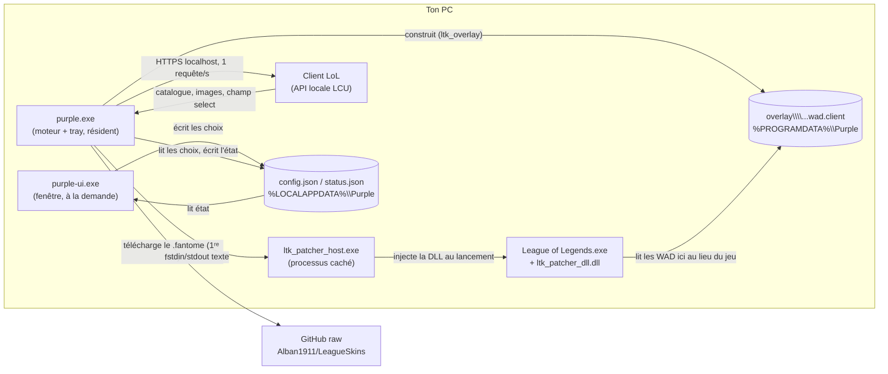

# Purple

Un changeur de skins pour League of Legends, écrit en Rust, qui ne dépend d'aucune autre application de skins.
Tu choisis un skin par champion dans une fenêtre ; quand tu sélectionnes ce champion en champ select, Purple
prépare le skin et le fait charger par le jeu. Le skin n'est visible que par toi (modification locale).

- Windows 10/11 uniquement. Testé sur EUW, client en français.
- Pas de compte, pas de serveur à nous, pas de télémétrie de notre part.
- Léger : le programme résident prend ~15 Mo de RAM (dont ~3,6 Mo propres), la fenêtre ~100 Mo seulement quand elle est ouverte.

> **Avertissement.** Riot n'autorise pas les skins qui reproduisent ses skins officiels. Purple modifie la lecture
> des fichiers du jeu côté client ; l'utilisation se fait à tes risques (suspension de compte possible). Projet
> personnel, non affilié à Riot Games.

---

## Utiliser

Prérequis : LoL installé, et le dossier `dist\Purple` (voir *Compiler* ci-dessous pour le produire).

1. Lance **`dist\Purple\purple.exe`**. Rien ne s'ouvre : une icône violette apparaît dans la zone de notification
   (Windows 11 la range d'abord sous la flèche « ^ » : glisse-la vers la barre).
2. **Clic gauche** sur l'icône (ou clic droit → *Open Purple*) : la fenêtre s'ouvre. Choisis un champion à gauche,
   clique un skin à droite (re-clique pour l'annuler, ou « Use the default skin »). Une pastille violette marque
   les champions qui ont un skin choisi.
3. Lance le client LoL et joue normalement : en champ select, dès que tu sélectionnes un champion qui a un skin
   choisi, Purple l'arme. Ferme la fenêtre quand tu veux : le moteur continue dans le tray.
4. Quitter : clic droit sur l'icône → *Quit* (pendant une partie, il attend la fin de la partie).

Les trois programmes doivent rester **dans le même dossier**, avec le sous-dossier `patcher\` :

| Fichier | Rôle |
|---|---|
| `purple.exe` | Programme résident : moteur + icône de zone de notification. **C'est celui qu'on lance.** |
| `purple-ui.exe` | La fenêtre (ouverte depuis l'icône ; ne tourne pas en permanence). |
| `purplectl.exe` | Ligne de commande de diagnostic (`status`, `skins`, `set`, `list`, `build`, `run`). |
| `patcher\` | `ltk_patcher_host.exe` + `ltk_patcher_dll.dll` (voir *Dépendances*). |

---

## Comment ça marche

### Vue d'ensemble



Il n'y a **pas de réseau entre les programmes de Purple** : la fenêtre et le moteur échangent par deux petits fichiers
JSON, et le moteur ne parle qu'au client LoL (en local) et à GitHub (pour télécharger un skin la première fois).

### Les trois couches d'un skin

1. **Le fichier de skin.** Un skin est une petite archive `.fantome` (un zip de ~5 Ko) qui contient
   `WAD/<Champion>.wad.client` avec deux minuscules fichiers `skin0.bin` : ils font pointer le skin de base du
   champion vers les données du skin voulu (par ex. `Skins/Skin1.bin`). Les modèles et textures, eux, sont déjà
   dans les fichiers du jeu : le skin n'est qu'une *redirection*. Ces archives viennent du dépôt
   `Alban1911/LeagueSkins` et sont mises en cache dans `%LOCALAPPDATA%\Purple\skins`.
2. **L'overlay.** Le jeu lit ses ressources dans des archives `DATA/FINAL/Champions/<Champion>.wad.client`.
   La crate `ltk_overlay` (LeagueToolkit, Apache-2.0) en fabrique une **copie** où les deux chunks du skin sont
   ajoutés à la fin, avec une table des matières mise à jour (~0,5 à 1 s, ~110 Mo par champion).
   L'archive officielle n'est jamais modifiée. Elle est écrite dans `%PROGRAMDATA%\Purple\overlay\<id du skin>\`.
3. **Le patcher.** Le jeu refuse normalement de lire autre chose que ses archives signées. `ltk_patcher_host.exe`
   attend le lancement de `League of Legends.exe`, y injecte `ltk_patcher_dll.dll`, qui redirige les lectures de
   l'archive du champion vers notre overlay et neutralise le contrôle d'intégrité. Sans lui, le skin est préparé
   mais jamais affiché.

### Ce que fait le moteur (`purple.exe`), chaque seconde

```
client fermé ──► attend (test toutes les 2 s)
client ouvert ─► lit /lol-gameflow/v1/gameflow-phase
ChampSelect ───► lit /lol-champ-select/v1/session → champion du joueur local
                 skin choisi pour ce champion ?
                   oui → télécharge le .fantome si besoin → construit l'overlay
                         → (ré)arme le patcher : « config prefix <overlay> », « start scan »
                   non → désarme
                 (changer de champion ou de skin pendant la sélection ré-arme)
InProgress ────► le patcher est attaché au jeu ; on ne le coupe jamais tant que la partie tourne
fin de partie ─► arrête la session du patcher
```

Le patcher doit être « en écoute » **avant** le lancement du jeu : il ne patche que les parties démarrées après
`start scan`. C'est pourquoi on arme dès le champ select (il reste ~30 s avant le chargement).

### Le protocole du patcher (texte sur stdin/stdout)

```
→ config loglevel 16          ← ok …
→ config flags 4              ← ok …      (4 = ne pas bloquer sur le scan « anti-skinhack » du DLL)
→ config prefix C:\...\overlay\<skin>\
→ start scan                  ← status … injecting | injected | waiting | exited | failed
→ stop
                              ← dll … <niveau> <message>   (journaux du DLL dans le jeu)
```

### Les trois programmes en détail

- **`purple.exe`** (`crates/purple/src/main.rs`) : crée l'icône (`tray-icon`), lance le moteur dans un thread, écrit
  `status.json` à chaque changement et réveille l'icône par un message Win32. Instance unique (mutex nommé) : un
  second lancement ouvre simplement la fenêtre. Le patcher est lancé sans fenêtre et rattaché à un **job Windows**
  `KILL_ON_JOB_CLOSE` : si `purple.exe` est tué ou plante, le patcher meurt avec lui (sinon il resterait actif et
  patcherait la prochaine partie avec un vieil overlay).
- **`purple-ui.exe`** (`gui.rs`) : fenêtre `egui`/`eframe` (OpenGL). Elle ne fait que **lire** `status.json` et
  **écrire** `config.json`. Elle charge portraits et vignettes depuis le client (cache disque), dans un thread.
  Instance unique : un second lancement remet la fenêtre existante au premier plan.
- **`purplectl.exe`** : mêmes briques en ligne de commande, pratique pour diagnostiquer
  (`purplectl run` affiche tout ce que fait le moteur ; **ne pas** le lancer en même temps que `purple.exe`).

### Modules (`crates/purple/src`)

| Module | Rôle |
|---|---|
| `engine.rs` | La boucle décrite plus haut ; émet des `Event` (utilisés par le tray et la CLI). |
| `lcu.rs` | Trouve le `lockfile` du client, client HTTPS local (certificat auto-signé accepté, localhost seulement). |
| `catalog.rs` | Champions et skins lus dans l'API de ressources du client ; cache `catalog.json`. |
| `store.rs` | Dossiers de données, téléchargement/cache des `.fantome`, journal `purple.log`. |
| `overlay.rs` | Construit l'overlay avec `ltk_overlay`. |
| `patcher.rs` | Lance et pilote `ltk_patcher_host.exe` (protocole ci-dessus). |
| `status.rs` | État partagé moteur → fenêtre (`status.json`). |
| `config.rs` | Choix de l'utilisateur : `champion id → skin id` (`config.json`). |
| `images.rs` | Chargement/réduction/cache des images, textures plafonnées. |
| `gui.rs` | La fenêtre. |
| `win.rs` | Aides Win32 : instance unique, focus, job object, boucle de messages. |
| `icon.rs` | L'icône (une perle violette dessinée en code, aucun fichier image). |

---

## Dépendances et services

### À l'exécution

| Quoi | Pour quoi | Quand | S'il est indisponible |
|---|---|---|---|
| **Client LoL (API LCU locale)** | Catalogue des champions/skins, noms, images, phase de jeu, champ select. | Toujours (localhost, sans internet). | Rien ne se passe ; la fenêtre affiche le dernier catalogue en cache. |
| **GitHub — `Alban1911/LeagueSkins`** (`raw.githubusercontent.com`) | Les fichiers `.fantome` de chaque skin. | Une fois par skin, à la première utilisation (ensuite en cache). | Les skins déjà en cache marchent ; un skin jamais utilisé ne peut pas être préparé. |
| **Binaires LTK Patcher** (LeagueToolkit) | Injection dans le jeu. **Binaires fermés**, non compilables par nous. | Toujours. | Rien n'est affiché en jeu. |

Les deux dépendances externes à surveiller :

- **Le patcher a une date de fin de vie.** Le DLL refuse les versions du jeu plus récentes que sa date
  (`end of life reached, please update`). À chaque grosse mise à jour du jeu, il peut falloir de nouveaux binaires :
  relance `scripts\get-patcher.ps1` puis `scripts\package.ps1`. Purple affiche un avertissement dans ce cas.
  Il n'est pas fourni dans ce dépôt (sa licence impose de re-signer en cas de redistribution) ; le script le télécharge
  depuis le dépôt `LeagueToolkit/ltk-manager`. Il est isolé derrière une interface minuscule (`patcher.rs`) : le
  remplacer ne touche pas au reste.
- **Le dépôt LeagueSkins** appartient à quelqu'un d'autre. Les skins pourraient être **générés localement** à partir
  des fichiers du jeu (un skin n'est qu'une redirection, voir plus haut) pour supprimer cette dépendance : pas encore fait.

### À la compilation

Rust, les crates de crates.io (notamment `ltk_overlay`, `ltk_wad`, `ltk_fantome`… de LeagueToolkit, Apache-2.0 ;
`egui`/`eframe` ; `tray-icon` ; `ureq` ; `image` ; `windows-sys`), et un compilateur C (la crate `zstd` en a besoin).

### Ce que Purple n'envoie à personne

Aucune télémétrie, aucun compte, aucun serveur à nous. Réseau sortant de Purple : GitHub (téléchargement de skins),
et GitHub aussi pour `get-patcher.ps1`. *Non vérifié* : ce que font les binaires du patcher de leur côté.

---

## Fichiers et dossiers

| Où | Contenu |
|---|---|
| `%LOCALAPPDATA%\Purple\config.json` | Tes choix : `{"skins": {"<id champion>": <id skin>}}`. |
| `%LOCALAPPDATA%\Purple\status.json` | État du moteur (client connecté, phase, skin armé, avertissements). |
| `%LOCALAPPDATA%\Purple\catalog.json` | Cache des champions et skins. |
| `%LOCALAPPDATA%\Purple\skins\`, `img\` | Cache des `.fantome` et des images. |
| `%LOCALAPPDATA%\Purple\purple.log` | Journal du moteur (le tray n'a pas de console). `PURPLE_DEBUG=1` pour tout le détail. |
| `%PROGRAMDATA%\Purple\overlay\`, `state\` | Overlays (~110 Mo, un seul gardé) et leur état de construction. |

Variables d'environnement : `PURPLE_DEBUG` (journaux complets du patcher), `PURPLE_DATA_DIR` (déplace *tous* les
dossiers de données), `PURPLE_PATCHER_DIR` (emplacement du patcher).

---

## Compiler

Prérequis : Rust (`rustup`) et un compilateur C. Sur la machine de développement il n'y avait pas les Build Tools
Visual Studio : on utilise la toolchain Rust **GNU** avec **w64devkit** (MinGW), sans toucher au PATH.

```powershell
.\scripts\get-patcher.ps1     # télécharge le patcher dans vendor\ltk-patcher (une fois, puis à chaque mise à jour du jeu)
.\scripts\package.ps1         # compile en release et assemble dist\Purple
```

Configuration de l'environnement :

- `rust-toolchain.toml` épingle `stable-x86_64-pc-windows-gnu` ; `.cargo/config.toml` contient les **chemins en dur**
  de w64devkit (`C:/Users/pierr/tools/w64devkit`) : adapte-les, ou, si tu as les Build Tools Visual Studio
  (C++), supprime ces deux fichiers pour utiliser la toolchain MSVC par défaut.
- Deux rustines propres à w64devkit : un `lib\libgcc_eh.a` **vide** à créer dans son dossier (Rust le réclame),
  et `-C dlltool=…` dans `.cargo/config.toml` (déjà fait).
- Dans Git Bash, le `link.exe` de coreutils masque celui de MSVC : lance `cargo` depuis PowerShell.

Tests : `cargo test -p purple` (17 tests : état, catalogue, protocole du patcher, job object, mutex, etc.) et
`cargo clippy -p purple --all-targets` (sans avertissement).

---

## Pièges déjà rencontrés (à ne pas refaire)

- **L'overlay doit être hors du profil utilisateur.** Dans `%LOCALAPPDATA%` (donc sous `C:\Users\<nom>`, dont les
  droits n'autorisent que le compte, SYSTEM et les admins) le jeu ne trouve rien : le patcher affiche
  `overlay verified 0 wad(s)` et aucun skin ne s'affiche. D'où `%PROGRAMDATA%\Purple`. Donner la lecture au seul
  dossier final ne suffit pas.
- **Le vieil outil `mod-tools.exe` (cslol) corrompt les archives actuelles.** Format WAD 3.4 (chunks « zstd +
  sous-chunks ») : le jeu répond `WadFile mount failed … Corrupt` puis lance une réparation. La crate moderne
  `ltk_overlay` ne modifie que 2 chunks sur ~4000 et marche.
- **Le patcher est un programme console** : lancé depuis un programme sans console, Windows lui ouvre une fenêtre
  noire ; il est donc lancé avec `CREATE_NO_WINDOW`.
- **Ne jamais couper le patcher sous un jeu en cours** (la fenêtre ne le fait pas ; « Quit » attend la fin de partie).
- Les champions `Jade_*` (ids ≥ 60000, autre mode de jeu) sont masqués : ils dupliquaient chaque nom.
- Le catalogue vient du client : **les noms de skins sont dans la langue du client**.

L'historique complet de la recherche et des diagnostics est dans [`docs/JOURNAL.md`](docs/JOURNAL.md).

---

## Limites et pistes

- Pas de chromas ni de formes spéciales ; pas de gestion des skins déjà possédés.
- Noms de skins dans la langue du client (les mêmes ids existent en anglais chez CommunityDragon : option possible).
- Mise à jour du patcher manuelle ; génération locale des skins (supprimer la dépendance à LeagueSkins) ; icône dans
  les `.exe` (ressource Windows) : à faire.
- Pas de lancement automatique avec Windows (volontairement : on lance le programme quand on veut).

## Structure du dépôt

```
crates/purple/        le code (lib + 3 binaires : purple, purple-ui, purplectl)
scripts/              get-patcher.ps1 (récupère le patcher), package.ps1 (assemble dist\Purple)
vendor/ltk-patcher/   emplacement du patcher (binaires ignorés par git) + sa licence
docs/JOURNAL.md       journal de recherche et de mise au point
.cargo/, rust-toolchain.toml   toolchain GNU + w64devkit (chemins propres à la machine de dév)
```

## Crédits et licences

Reposent sur le travail de la communauté : **LeagueToolkit** (`ltk_overlay` et crates associées, LTK Patcher),
**Alban1911/Rose** et son dépôt **LeagueSkins** (fichiers de skins), **CommunityDragon** (données). Les binaires
du LTK Patcher sont soumis à leur propre licence (`vendor/ltk-patcher/LTK-PATCHER-LICENSE.md`). Purple lui-même n'a
pas encore de licence.
