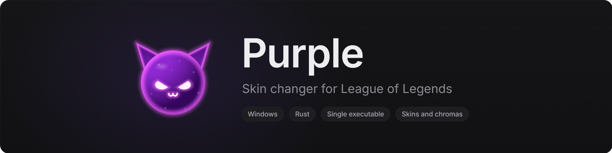
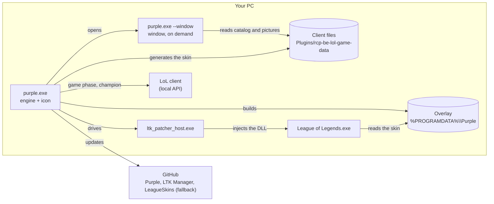

<p align="center">
  
</p>

<p align="center">
  <a href="https://github.com/AlexLynx77/Purple/releases/latest"></a>
  
  <a href="LICENSE"></a>
</p>

Skin changer for League of Legends. A single Windows executable, written in Rust.

Pick a skin for each champion. When you pick that champion in champion select, Purple prepares the skin and has the
game load it. Only you see the skin: the change is local.

> [!WARNING]
> Riot Games does not allow tools that modify game files, even client-side. Use them at your own risk (your account
> may be suspended). Purple is a personal project, not affiliated with Riot Games.

## Contents

- [Features](#features)
- [Installation](#installation)
- [Usage](#usage)
- [How it works](#how-it-works)
- [External dependencies](#external-dependencies)
- [Data and configuration](#data-and-configuration)
- [Troubleshooting](#troubleshooting)
- [Development](#development)
- [Roadmap](#roadmap)
- [Credits and licenses](#credits-and-licenses)

## Features

- **A single file**, `purple.exe`: no installer, no other skin application.
- **Skins and chromas**, including the default skin's chromas.
- **Skins generated locally** from the game's files; downloaded from LeagueSkins only as a fallback.
- **Works with the client closed**: champions, skins and pictures are read straight from the League of Legends files.
- **Patcher kept up to date automatically**: Purple downloads the official release and checks its signature.
- **One-click updates**: Purple looks for a new release at startup and then daily, replaces itself and restarts;
  only one `purple.exe` is left.
- **Lightweight**: ~18 MB of RAM in the background; the window (~110 MB) frees its memory as soon as it is closed.
- **No account, no telemetry.**
- **Non-destructive**: the game's archives are never modified.

Tested on Windows 11, EUW server, French client.

## Installation

1. Download `purple.exe` from the [Releases](https://github.com/AlexLynx77/Purple/releases) page.
2. Put it anywhere you like and run it.

On first launch, Purple downloads LTK Patcher (≈ 2 MB), so an internet connection is needed that time.

Requirements: Windows 10 or 11 (64-bit) and League of Legends installed.

## Usage

1. Run `purple.exe`. The window opens and an icon appears in the notification area.
2. Pick a champion on the left, then a skin. **Default** restores the base skin. Champions with a chosen skin are
   marked with a dot and the skin's name.
3. For a chroma: click the small circle at the bottom right of the skin's picture, then a colour. The empty circle
   goes back to the skin without a chroma.
4. Play as usual. In champion select, Purple prepares the chosen champion's skin (≈ 1 s).
5. Closing the window keeps Purple running in the notification area. Clicking the icon opens it again.
6. To quit: right-click the icon → *Quit*. During a game, Purple waits for it to end.
7. When a new version is released, a banner offers to update. Purple downloads it, replaces itself and restarts
   (not during a game).

`purple.exe --background` starts straight in the notification area, without opening the window.

## How it works



The engine and the window are two processes of the same executable. They communicate through two JSON files
(`config.json`, `status.json`).

### Steps of a skin

1. **Skin file.** A skin is a `.fantome` archive of a few KB that redirects the champion's base skin to the data of
   the chosen skin (or chroma), already present in the game. Purple generates it from the champion's archive
   (`skingen.rs`) and generates it again after each patch. Out of 374 skins tested, 359 are identical to the files of
   the [LeagueSkins](https://github.com/Alban1911/LeagueSkins) repository; the others contain hand-made fixes. If
   generation fails, Purple downloads the file from LeagueSkins (`PURPLE_SKIN_SOURCE=leagueskins` reverses this order).
2. **Overlay.** The `ltk_overlay` library creates a copy of the champion's archive (`<Champion>.wad.client`) with the
   skin added. Rebuilds are incremental.
3. **Patcher.** `ltk_patcher_host.exe` waits for the game to start and injects a DLL that makes it read the overlay
   instead of the original archive. It must be armed before the game starts, hence the preparation during champion
   select.

### Engine cycle

```
client closed ─► waits
ChampSelect ───► champion picked → skin chosen?
                   yes → gets the skin → builds the overlay → arms the patcher
                   no  → disarms
InProgress ────► the patcher stays attached to the game until it ends
game over ─────► stops the patcher session
```

### Code layout

One library and one executable in [`crates/purple`](crates/purple).

| Module | Role |
|---|---|
| `main.rs` | Entry point: engine + icon, window (`--window`) or command line. |
| `gui.rs`, `images.rs` | Window (`egui`) and picture loading. |
| `engine.rs` | Engine loop. |
| `lcu.rs` | Client local API (game phase, champion select). |
| `client_assets.rs` | Reads the catalog and pictures from the client's files. |
| `catalog.rs` | Champions, skins and chromas. |
| `skingen.rs` | Generates skin files from the game's files. |
| `store.rs` | Data folders, skin cache (generated or downloaded), log. |
| `overlay.rs` | Builds the overlay. |
| `patcher.rs`, `patcher_install.rs` | Drives the patcher; download, verification and updates. |
| `update.rs` | Updates Purple from its GitHub releases (`self-replace`). |
| `cli.rs` | Diagnostic commands. |
| `config.rs`, `status.rs` | User choices, state shared with the window. |
| `win.rs`, `icon.rs` | Win32 helpers; logo drawn in code (`build.rs` embeds it in the executable). |

## External dependencies

| Dependency | Role | After a game patch |
|---|---|---|
| **LTK Patcher** ([LeagueToolkit/ltk-manager](https://github.com/LeagueToolkit/ltk-manager)), closed-source binaries | Injection into the game | Nothing to do: Purple installs the latest stable release at startup and as soon as the patcher reports it is too old. |
| **[LeagueSkins](https://github.com/Alban1911/LeagueSkins)** | Fallback when local generation fails | Nothing to do: cached files are revalidated. |
| **LeagueToolkit crates** (`ltk_overlay`, `ltk_wad`…), Apache-2.0 | Reading and writing the game's archives | Update only if the archive format changes. |

Purple does not redistribute LTK Patcher: its license requires removing LeagueToolkit's signature when redistributing
it. Purple therefore downloads the official files and refuses any whose Authenticode signature is not valid.

The catalog, pictures and skins depend on no service: they come from the League of Legends installation. Only GitHub
(Purple and patcher updates, fallback skins) and the client's local API are contacted. No telemetry. The network
behaviour of the patcher's closed-source binaries has not been checked.

## Data and configuration

| Location | Contents |
|---|---|
| `%LOCALAPPDATA%\Purple\config.json` | Skin choices: `{"skins": {"<champion id>": <skin id>}}`. |
| `%LOCALAPPDATA%\Purple\status.json` | Engine state. |
| `%LOCALAPPDATA%\Purple\catalog.json`, `img\`, `skins\` | Caches: catalog, pictures, skin files. |
| `%LOCALAPPDATA%\Purple\purple.log` | Log (cleared past 1 MB). |
| `%PROGRAMDATA%\Purple\patcher\` | LTK Patcher, one folder per version. |
| `%PROGRAMDATA%\Purple\overlay\`, `state\` | Overlay of the last prepared skin (≈ 110 MB). |

The overlay and the patcher live outside the user profile: the game cannot read under `C:\Users\<name>`.

| Environment variable | Effect |
|---|---|
| `PURPLE_DEBUG=1` | Detailed patcher log. |
| `PURPLE_DATA_DIR` | Keeps all data in this folder (tests). |
| `PURPLE_PATCHER_DIR` | Uses this patcher instead of the one Purple manages. |
| `PURPLE_SKIN_SOURCE=leagueskins` | Prefers LeagueSkins' files over generated skins. |
| `PURPLE_UPDATE_URL` | Asks this address instead of the GitHub API for the latest release (tests). |

## Troubleshooting

| Symptom | Solution |
|---|---|
| Warning "LTK Patcher does not support this game version yet" | Wait for the LTK Manager release that follows the patch; Purple installs it by itself. To check now: `purple.exe update-patcher`. |
| "Could not update Purple" | Purple must be able to write to the folder of `purple.exe`: move it (to `Documents`, for example) or download the release by hand. |
| Skin prepared but not visible in game | Check `purple.log`; make sure `%PROGRAMDATA%\Purple` is accessible. |
| A skin does not apply | `purple.exe build <champion id> <skin id>` tells whether it was generated or downloaded, and why it failed. |
| Nothing happens in champion select | Check the state at the bottom left of the window, then `purple.log`. |

On the command line (`purple.exe help`): `status`, `skins <champion>`, `set`, `unset`, `list`, `update-patcher`, and
`run`, which follows the engine live (run it with no other Purple instance active).

## Development

Requirements: [Rust](https://rustup.rs) and a C compiler (needed by `zstd`).

```powershell
.\scripts\package.ps1         # release build, copied to dist\purple.exe
```

The repository uses the **GNU** Rust toolchain with [w64devkit](https://github.com/skeeto/w64devkit):
`rust-toolchain.toml` pins `stable-x86_64-pc-windows-gnu` and `.cargo/config.toml` holds the w64devkit paths (adapt
them). With the Visual Studio Build Tools, delete these two files to use MSVC. w64devkit needs an empty
`lib\libgcc_eh.a` file. Run `cargo` from PowerShell.

```powershell
cargo test -p purple
cargo clippy -p purple --all-targets
```

`PURPLE_SCREENSHOT=<file.png>` (with `purple.exe --window`) saves a capture of the window, then closes it;
`PURPLE_SCREENSHOT_CHAMPION` picks the champion shown and `PURPLE_SCREENSHOT_PICKER=1` opens the chroma picker.

Notes:

- `zip` is pinned to 2.4.2: 2.6.1 breaks the `ltk_fantome` build.
- Champions of alternate modes (ids ≥ 60000) are hidden.
- The research history is in [`docs/JOURNAL.md`](docs/JOURNAL.md).

## Roadmap

- [ ] Special forms (skins with several forms, tiered Prestige skins)

## Credits and licenses

- [LeagueToolkit](https://github.com/LeagueToolkit): `ltk_*` crates (Apache-2.0) and LTK Patcher (own license, see
  `LTK-PATCHER-LICENSE.md` in [ltk-manager](https://github.com/LeagueToolkit/ltk-manager)).
- [Alban1911/LeagueSkins](https://github.com/Alban1911/LeagueSkins): skin files.

Purple is released under the [MIT](LICENSE) license. It covers Purple's code, not LTK Patcher nor the skin files,
which keep their own licenses. League of Legends is a trademark of Riot Games, Inc.
