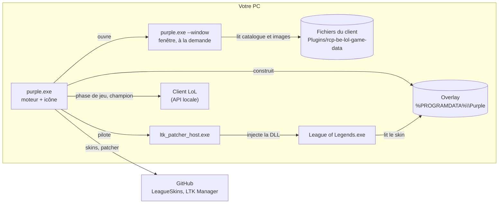

# Purple

Changeur de skins pour League of Legends. Un seul exécutable Windows, écrit en Rust.

Choisissez un skin par champion. Lorsque vous sélectionnez ce champion en sélection des champions, Purple prépare
le skin et le fait charger par le jeu. Le skin n'est visible que par vous : la modification est locale.

> [!WARNING]
> Riot Games n'autorise pas les outils qui modifient les fichiers du jeu, même côté client. Leur utilisation se fait
> à vos risques (une suspension de compte est possible). Purple est un projet personnel, sans lien avec Riot Games.

## Sommaire

- [Caractéristiques](#caractéristiques)
- [Installation](#installation)
- [Utilisation](#utilisation)
- [Fonctionnement](#fonctionnement)
- [Dépendances externes](#dépendances-externes)
- [Données et configuration](#données-et-configuration)
- [Dépannage](#dépannage)
- [Développement](#développement)
- [Feuille de route](#feuille-de-route)
- [Crédits et licences](#crédits-et-licences)

## Caractéristiques

- **Un seul fichier**, `purple.exe`, sans installation ni autre application de skins.
- **Fonctionne client fermé** : champions, skins et images sont lus directement dans les fichiers de League of Legends.
- **Patcher tenu à jour automatiquement** : Purple télécharge la version officielle et vérifie sa signature.
- **Léger** : ~18 Mo de RAM en arrière-plan ; la fenêtre (~110 Mo) libère sa mémoire dès qu'elle est fermée.
- **Sans compte ni télémétrie.**
- **Non destructif** : les archives du jeu ne sont jamais modifiées.

Testé sous Windows 11, serveur EUW, client en français.

## Installation

1. Téléchargez `purple.exe` depuis la page [Releases](https://github.com/AlexLynx77/Purple/releases).
2. Placez-le où vous voulez et lancez-le.

Au premier lancement, Purple télécharge LTK Patcher (≈ 2 Mo) ; une connexion internet est nécessaire cette fois-là.

Prérequis : Windows 10 ou 11 (64 bits) et League of Legends installé.

## Utilisation

1. Lancez `purple.exe`. La fenêtre s'ouvre et une icône apparaît dans la zone de notification.
2. Choisissez un champion à gauche, puis un skin. **Default** rétablit le skin de base. Les champions qui ont un skin
   choisi sont signalés par un point et le nom du skin.
3. Jouez normalement. En sélection des champions, Purple prépare le skin du champion choisi (≈ 1 s).
4. Fermer la fenêtre laisse Purple actif dans la zone de notification. Un clic sur l'icône la rouvre.
5. Pour quitter : clic droit sur l'icône → *Quit*. Pendant une partie, Purple attend sa fin.

`purple.exe --background` démarre directement dans la zone de notification, sans ouvrir la fenêtre.

## Fonctionnement



Le moteur et la fenêtre sont deux processus du même exécutable. Ils communiquent par deux fichiers JSON
(`config.json`, `status.json`).

### Les étapes d'un skin

1. **Fichier de skin.** Un skin est une archive `.fantome` de quelques Ko qui redirige le skin de base du champion vers
   les données du skin choisi, déjà présentes dans le jeu. Ces archives proviennent du dépôt
   [LeagueSkins](https://github.com/Alban1911/LeagueSkins), régénéré à chaque patch. Purple les met en cache et les
   revalide à chaque utilisation.
2. **Overlay.** La bibliothèque `ltk_overlay` crée une copie de l'archive du champion (`<Champion>.wad.client`) à
   laquelle le skin est ajouté. La reconstruction est incrémentale.
3. **Patcher.** `ltk_patcher_host.exe` attend le lancement du jeu et y injecte une DLL qui lui fait lire l'overlay au
   lieu de l'archive d'origine. Il doit être armé avant le lancement de la partie, d'où la préparation dès la
   sélection des champions.

### Cycle du moteur

```
client fermé ──► attend
ChampSelect ───► champion choisi → skin configuré ?
                   oui → récupère le skin → construit l'overlay → arme le patcher
                   non → désarme
InProgress ────► le patcher reste attaché au jeu jusqu'à la fin de la partie
fin de partie ─► arrête la session du patcher
```

### Architecture du code

Une bibliothèque et un exécutable dans [`crates/purple`](crates/purple).

| Module | Rôle |
|---|---|
| `main.rs` | Point d'entrée : moteur + icône, fenêtre (`--window`) ou ligne de commande. |
| `gui.rs`, `images.rs` | Fenêtre (`egui`) et chargement des images. |
| `engine.rs` | Boucle du moteur. |
| `lcu.rs` | API locale du client (phase de jeu, sélection des champions). |
| `client_assets.rs` | Lecture du catalogue et des images dans les fichiers du client. |
| `catalog.rs` | Champions et skins. |
| `store.rs` | Dossiers de données, cache des skins, journal. |
| `overlay.rs` | Construction de l'overlay. |
| `patcher.rs`, `patcher_install.rs` | Pilotage du patcher ; téléchargement, vérification et mise à jour. |
| `cli.rs` | Commandes de diagnostic. |
| `config.rs`, `status.rs` | Choix de l'utilisateur, état partagé avec la fenêtre. |
| `win.rs`, `icon.rs` | Aides Win32 ; logo dessiné en code (`build.rs` l'intègre à l'exécutable). |

## Dépendances externes

| Dépendance | Rôle | Après un patch du jeu |
|---|---|---|
| **LTK Patcher** ([LeagueToolkit/ltk-manager](https://github.com/LeagueToolkit/ltk-manager)), binaires fermés | Injection dans le jeu | Rien à faire : Purple installe la dernière release stable au démarrage et dès que le patcher signale qu'il est trop ancien. |
| **[LeagueSkins](https://github.com/Alban1911/LeagueSkins)** | Fichiers de skins | Rien à faire : les skins en cache sont revalidés. |
| **Crates LeagueToolkit** (`ltk_overlay`, `ltk_wad`…), Apache-2.0 | Lecture et écriture des archives du jeu | Mise à jour seulement si le format des archives change. |

Purple ne redistribue pas LTK Patcher : sa licence impose de retirer la signature de LeagueToolkit en cas de
redistribution. Purple télécharge donc les fichiers officiels et refuse ceux dont la signature Authenticode n'est pas
valide.

Le catalogue et les images ne dépendent d'aucun service : ils sont lus dans l'installation de League of Legends.
Seuls GitHub (skins et patcher) et l'API locale du client sont contactés. Aucune télémétrie. Le comportement réseau
des binaires fermés du patcher n'a pas été vérifié.

## Données et configuration

| Emplacement | Contenu |
|---|---|
| `%LOCALAPPDATA%\Purple\config.json` | Choix de skins : `{"skins": {"<id champion>": <id skin>}}`. |
| `%LOCALAPPDATA%\Purple\status.json` | État du moteur. |
| `%LOCALAPPDATA%\Purple\catalog.json`, `img\`, `skins\` | Caches : catalogue, images, fichiers de skins. |
| `%LOCALAPPDATA%\Purple\purple.log` | Journal (remis à zéro au-delà de 1 Mo). |
| `%PROGRAMDATA%\Purple\patcher\` | LTK Patcher, un dossier par version. |
| `%PROGRAMDATA%\Purple\overlay\`, `state\` | Overlay du dernier skin préparé (≈ 110 Mo). |

L'overlay et le patcher sont hors du profil utilisateur : le jeu ne peut pas lire sous `C:\Users\<nom>`.

| Variable d'environnement | Effet |
|---|---|
| `PURPLE_DEBUG=1` | Journal détaillé du patcher. |
| `PURPLE_DATA_DIR` | Regroupe toutes les données dans ce dossier (tests). |
| `PURPLE_PATCHER_DIR` | Utilise ce patcher au lieu de la version gérée par Purple. |

## Dépannage

| Symptôme | Solution |
|---|---|
| Avertissement « LTK Patcher does not support this game version yet » | Attendre la release de LTK Manager qui suit le patch ; Purple l'installe seul. Forcer la vérification : `purple.exe update-patcher`. |
| Skin préparé mais invisible en jeu | Consulter `purple.log` ; vérifier que `%PROGRAMDATA%\Purple` est accessible. |
| « no skin file for … in the LeagueSkins repository » | Skin pas encore disponible dans le dépôt (souvent un skin récent). |
| Rien ne se passe en sélection des champions | Vérifier l'état en bas à gauche de la fenêtre, puis `purple.log`. |

En ligne de commande (`purple.exe help`) : `status`, `skins <champion>`, `set`, `unset`, `list`, `update-patcher`, et
`run`, qui suit le moteur en direct (à lancer sans autre instance de Purple active).

## Développement

Prérequis : [Rust](https://rustup.rs) et un compilateur C (requis par `zstd`).

```powershell
.\scripts\package.ps1         # compile en release et copie dist\purple.exe
```

Le dépôt utilise la toolchain Rust **GNU** avec [w64devkit](https://github.com/skeeto/w64devkit) :
`rust-toolchain.toml` épingle `stable-x86_64-pc-windows-gnu` et `.cargo/config.toml` contient les chemins de w64devkit
(à adapter). Avec les Build Tools Visual Studio, supprimez ces deux fichiers pour utiliser MSVC. w64devkit nécessite un
fichier vide `lib\libgcc_eh.a`. Lancez `cargo` depuis PowerShell.

```powershell
cargo test -p purple
cargo clippy -p purple --all-targets
```

`PURPLE_SCREENSHOT=<fichier.png>` (avec `purple.exe --window`) enregistre une capture de la fenêtre puis la ferme ;
`PURPLE_SCREENSHOT_CHAMPION` choisit le champion affiché.

Notes :

- `zip` est épinglé à 2.4.2 : la 2.6.1 casse la compilation de `ltk_fantome`.
- Les champions des modes alternatifs (ids ≥ 60000) sont masqués.
- L'historique des recherches est dans [`docs/JOURNAL.md`](docs/JOURNAL.md).

## Feuille de route

- [ ] Génération locale des skins, LeagueSkins en secours
- [ ] Chromas et formes spéciales

## Crédits et licences

- [LeagueToolkit](https://github.com/LeagueToolkit) : crates `ltk_*` (Apache-2.0) et LTK Patcher (licence propre,
  voir `LTK-PATCHER-LICENSE.md` dans [ltk-manager](https://github.com/LeagueToolkit/ltk-manager)).
- [Alban1911/LeagueSkins](https://github.com/Alban1911/LeagueSkins) : fichiers de skins.

Purple n'a pas encore de licence. League of Legends est une marque de Riot Games, Inc.
